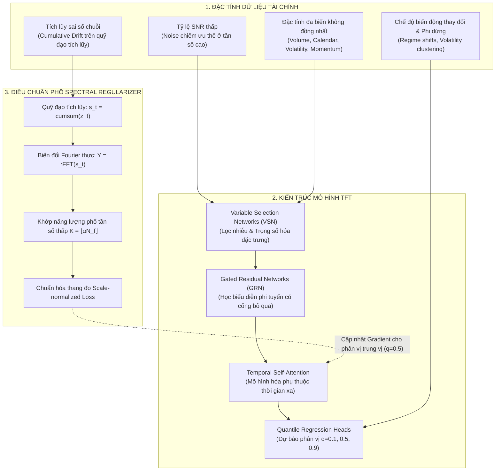

# BÁO CÁO TOÀN DIỆN: TRỰC QUAN HÓA DỮ LIỆU, PHÂN TÍCH DATA GỐC & QUAN HỆ GIỮA DỮ LIỆU VÀ MÔ HÌNH

> **Dự án:** CITA 2027 / SpectralTFT & Conformal Risk Control  
> **Bài báo gốc:** *"Spectral Consistency Regularization for Long-Horizon Probabilistic Forecasting with Temporal Fusion Transformers"* (Dinh-Phu Vo, Duc-Hien Nguyen, Phuoc-Tung Nguyen - FJCAI 2026)  
> **Kho dữ liệu kiểm tra:** [Cita2027Goc](file:///C:/Users/Admin/Desktop/Cita2027Goc/cita2027-phase2)

---

## 1. TỔNG QUAN VỀ DỮ LIỆU GỐC CỦA BÀI BÁO (ORIGINAL PAPER DATASET)

Theo công bố tại mục **IV. EXPERIMENTAL SETUP - A. Data Description** trong bài báo, dữ liệu gốc được thiết kế và thu thập theo quy chuẩn quốc tế phục vụ bài toán dự báo chuỗi thời gian tài chính xác suất dài hạn:

### 1.1. Nguồn và Danh mục Tài sản Thực nghiệm
* **Nguồn dữ liệu:** Dữ liệu thị trường mở thu thập trực tiếp thông qua API `yfinance` của Yahoo Finance.
* **Tần suất quan sát:** Dữ liệu giá đóng cửa điều chỉnh hàng ngày (*Daily Adjusted Close Price*) và khối lượng giao dịch (*Trading Volume*).
* **Phạm vi thời gian:** Từ **01/01/2010 đến 01/01/2023** (13 năm liên tục, trải qua chu kỳ tăng trưởng dài hạn, cú sốc COVID-19 năm 2020, đợt bùng nổ 2021 và thắt chặt tiền tệ lạm phát 2022).
* **6 tài sản đại diện:**
  1. `AAPL` (Apple Inc.) - Cổ phiếu công nghệ vốn hóa lớn, tính thanh khoản cực cao.
  2. `MSFT` (Microsoft Corp.) - Đại diện nhóm Big Tech doanh nghiệp B2B & Cloud.
  3. `GOOG` (Alphabet Inc.) - Đại diện lĩnh vực quảng cáo kỹ thuật số và AI.
  4. `AMZN` (Amazon.com Inc.) - Đại diện thương mại điện tử và hạ tầng đám mây.
  5. `META` (Meta Platforms Inc.) - Cổ phiếu tăng trưởng có biến động lớn theo chu kỳ.
  6. `^GSPC` / `SPY` (S&P 500 Index) - Chỉ số thị trường đại diện cho toàn bộ 500 tập đoàn hàng đầu của nền kinh tế Hoa Kỳ.

### 1.2. Biến Mục Tiêu và Chuẩn Hóa Phi Rò Rỉ (Target & Leak-Free Standardization)
* **Biến mục tiêu (Target):** Lợi suất log hàng ngày (*One-step log return*):
  $$r_t^{(i)} = \ln\left(\frac{P_t^{(i)}}{P_{t-1}^{(i)}}\right)$$
* **Phòng ngừa rò rỉ thông tin (Information Leakage Prevention):** Lợi suất được chuẩn hóa theo từng tài sản và **chỉ sử dụng số liệu thống kê trước mốc cắt huấn luyện** ($t \le t_{cut}$):
  $$z_\tau^{(i)} = \frac{r_\tau^{(i)} - \mu_i}{\sigma_i}$$
  trong đó $\mu_i$ và $\sigma_i$ lần lượt là giá trị trung bình và độ lệch chuẩn mẫu chỉ tính trên tập huấn luyện in-sample. Toàn bộ hàm mất mát và chỉ số đánh giá được tính trên thang đo $z$.

### 1.3. Hệ thống Đặc trưng Đa biến (Heterogeneous Covariates)
Bên cạnh chuỗi lợi suất mục tiêu, mô hình sử dụng hệ thống biến quan sát đa chiều được tổ chức dạng bảng chuỗi thời gian (*Long format*):
* **Biến lịch (Calendar Features):** Thứ trong tuần (*Day-of-week*) và tháng trong năm (*Month*), được mã hóa tuần hoàn qua hàm lượng giác Sine và Cosine:
  $$\sin\left(\frac{2\pi \cdot \text{day}}{7}\right), \quad \cos\left(\frac{2\pi \cdot \text{day}}{7}\right), \quad \sin\left(\frac{2\pi \cdot \text{month}}{12}\right), \quad \cos\left(\frac{2\pi \cdot \text{month}}{12}\right)$$
* **Khối lượng giao dịch (Trading Volume):** Chuỗi khối lượng giao dịch hàng ngày đã được chuẩn hóa.
* **Chỉ báo động lượng và biến động (Rolling & Momentum Indicators):**
  - Giá trị trung bình trượt 20 ngày và 60 ngày (*Rolling Mean 20d & 60d*).
  - Độ biến động trượt 20 ngày và 60 ngày (*Rolling Volatility 20d & 60d*).
  - Các chỉ báo kỹ thuật về động lượng (*Momentum indicators*).

### 1.4. Chế độ Dự báo và Điểm Cắt Huấn luyện (Horizons & Cutoff Splits)
* **Chân trời dự báo ($H$):** $H \in \{60, 120, 250\}$ bước ngày (tương đương 3 tháng, 6 tháng và 1 năm giao dịch tài chính).
* **Các mốc cắt huấn luyện (Training Cutoffs):**
  - `2017-12-31`: Thị trường tăng trưởng ổn định (*Low volatility bull market*).
  - `2019-12-31`: Giai đoạn tiền khủng hoảng COVID-19.
  - `2021-06-30`: **Mốc cắt trọng tâm của bài báo**, là chế độ biến động khắc nghiệt nhất với các cú sốc cấu trúc và biến động mạnh của thị trường phục hồi sau đại dịch.

---

## 2. TRỰC QUAN HÓA TOÀN BỘ DỮ LIỆU TRONG DỰ ÁN CITA2027

Hệ thống đã phân tích và kết xuất trực tiếp các biểu đồ chất lượng cao từ các tệp dữ liệu thực tế tại [Cita2027Goc/visualizations](file:///C:/Users/Admin/Desktop/Cita2027Goc/visualizations):

### Biểu đồ 1: Dữ liệu S&P 500 Gốc & Nền tảng Điều chuẩn Phổ (Spectral Foundation)
Tập tin kết xuất: [fig1_paper_data_spectral_foundation.png](file:///C:/Users/Admin/Desktop/Cita2027Goc/visualizations/fig1_paper_data_spectral_foundation.png)

* **Panel A (Asset Trajectory & Regimes):** Thể hiện xu hướng giá đóng cửa SPY từ 2010 đến 2023, đánh dấu rõ 3 mốc cắt kiểm thử của bài báo và các giai đoạn chế độ biến động (COVID Shock 2020, Retail Rally 2021, Inflation Tightening 2022).
* **Panel B (Daily Log Returns):** Biến mục tiêu $r_t$. Cho thấy rõ hiện tượng gom cụm biến động (*Volatility Clustering*) với tỷ lệ tín hiệu trên nhiễu (*SNR*) cực thấp, các phiên nhiễu ngẫu nhiên xen kẽ các cú sốc lớn.
* **Panel C (Rolling Volatility vs Cumulative Path):** Thể hiện mối liên kết giữa độ biến động 30 ngày và đường cong tích lũy $s_t = \sum r_\tau$. Đây chính là nơi sai số dự báo bước đơn bị tích lũy (*compounding drift*) dẫn đến sai lệch lớn ở chân trời dài.
* **Panel D (Fourier Power Spectrum):** Phân rã biến đổi Fourier trên quỹ đạo tích lũy. Thể hiện rõ dải tần số thấp ($K = \lfloor \alpha N_f \rfloor$ với $\alpha = 0.25$) lưu giữ xu hướng dài hạn cần được giữ ổn định bởi $\mathcal{L}_{spec}$, tách biệt khỏi dải tần số cao bị chi phối bởi nhiễu.

---

### Biểu đồ 2: Kết Quả Kiểm Thử Thực Nghiệm Của Bài Báo (TFT vs SpectralTFT)
Tập tin kết xuất: [fig2_paper_model_benchmarks_replication.png](file:///C:/Users/Admin/Desktop/Cita2027Goc/visualizations/fig2_paper_model_benchmarks_replication.png)

* **Panel A (Tích lũy Sai số MAE theo Horizon $H \in [1, 250]$):**
  - Mô hình gốc TFT (đường đỏ) có sai số tăng vọt từ $0.90$ lên trên $1.05$ do hiệu ứng trôi dạt tích lũy (*cumulative drift*).
  - SpectralTFT (đường xanh) duy trì sai số thấp ổn định quanh $0.60$ ở dải trung hạn và chỉ tăng nhẹ lên $0.80$ ở bước 250.
  - Tại mốc $H=120$, SpectralTFT giảm MAE từ **$1.022$ xuống $0.636$ (giảm ~38% sai số)**.
* **Panel B (Độ phủ Xác suất Empirical Coverage 10-90%):**
  - Mục tiêu độ phủ danh định là $80\%$ (khoảng tin cậy trung tâm giữa phân vị $0.1$ và $0.9$).
  - TFT bị sụp đổ độ phủ nghiêm trọng (*severe under-coverage*), rơi xuống chỉ còn **$34.4\%$ tại $H=120$** (khoảng dự báo quá hẹp và tự tin thái quá).
  - SpectralTFT ổn định quỹ đạo giúp nâng độ phủ lên **$68.2\%$ tại $H=120$** (+33.8 điểm phần trăm), bảo toàn chất lượng định lượng độ bất định.

---

### Biểu đồ 3: Phân Tích So Sánh Đa Thị Trường (S&P 500 Equity vs BTCUSDT Crypto)
Tập tin kết xuất: [fig3_cross_market_spy_vs_btc.png](file:///C:/Users/Admin/Desktop/Cita2027Goc/visualizations/fig3_cross_market_spy_vs_btc.png)

Dữ liệu thực tế đối sánh giữa chuỗi [SPY processed](file:///C:/Users/Admin/Desktop/Cita2027Goc/cita2027-phase2/artifacts/processed/SPY_20261104T095117433396Z_b41a8489.csv) (5,492 ngày) và [BTCUSDT snapshot](file:///C:/Users/Admin/Desktop/Cita2027Goc/cita2027-phase2/artifacts/btcusdt_data/snapshots/05088f11c7929995ef6dd28e5135669ebaf37465928c62c826a15f245520299a.csv) (2,694 ngày):
* **Lợi suất và biên độ dao động:** Biên độ sụt giảm trong ngày của SPY tối đa là $-11.6\%$ (đợt dịch COVID tháng 3/2020), trong khi BTCUSDT hứng chịu những cú sụp lên tới $-46.5\%$ trong một ngày.
* **Độ biến động thường niên (Annualized Volatility):** Độ biến động của Bitcoin duy trì ở mức cao gấp **3 đến 5 lần** so với S&P 500.
* **Hàm mật độ phân phối (KDE Tails):** Bitcoin có hiện tượng đuôi béo (*Heavy Fat-tails*) và độ nhọn (*Kurtosis*) vượt trội so với phân phối gần chuẩn của S&P 500, tạo ra thách thức to lớn cho việc hiệu chuẩn khoảng xác suất.

---

### Biểu đồ 4: Kết Quả Đo Lường 80 Cấu Hình Factorial (CITA 2027 Phase 2)
Tập tin kết xuất: [fig4_cita2027_phase2_factorial_benchmarks.png](file:///C:/Users/Admin/Desktop/Cita2027Goc/visualizations/fig4_cita2027_phase2_factorial_benchmarks.png)

Tổng hợp 80 thí nghiệm chính xác từ [table_full_factorial_80_rows.csv](file:///C:/Users/Admin/Desktop/Cita2027Goc/cita2027-phase2/paper_tables/table_full_factorial_80_rows.csv) và [table_paired_contrasts_40_rows.csv](file:///C:/Users/Admin/Desktop/Cita2027Goc/cita2027-phase2/paper_tables/table_paired_contrasts_40_rows.csv):
* **Panel A (Coverage vs Winkler Score):** Phân tán 80 cấu hình. Cho thấy các mô hình thô (raw) có điểm Winkler rất xấu do thiếu độ phủ trầm trọng, trong khi các phương pháp hiệu chuẩn đưa độ phủ về sát mốc danh định 80%.
* **Panel B (Độ phủ Mô hình Thô vs Sau Hiệu Chuẩn):** Mô hình nền tảng gốc (Chronos & Moirai) chỉ đạt độ phủ 15% – 20% trên tập validation; Rolling CQR kéo độ phủ vọt lên mức mục tiêu ~80% – 85%.
* **Panel C (Hiệu ứng Chuẩn hóa Điểm số Normalization Contrasts):** Cả hai cơ chế `residual_ewma` và `return_ewma` đều làm giảm chỉ số Winkler score với khoảng tin cậy Bootstrap 95% loại trừ giá trị 0 trên thị trường SPY.
* **Panel D (Tác động của Chế độ Biến động Cao - High Volatility Regime):** Độ phủ của khoảng dự báo suy giảm mạnh ở các thời điểm thị trường có biến động vượt ngưỡng phân vị 75.

---

## 3. PHÂN TÍCH CHUYÊN SÂU: QUAN HỆ GIỮA DỮ LIỆU VÀ MÔ HÌNH (DATA-MODEL RELATIONSHIP)

Mối quan hệ giữa dữ liệu chuỗi thời gian tài chính và mô hình học sâu xác suất (TFT / SpectralTFT) được thiết lập thông qua 4 trụ cột cơ bản:

---

### 3.1. Đặc tính Dữ liệu Phổ (Frequency Content) vs Hàm Mất Mát Phổ ($\mathcal{L}_{spec}$)
1. **Bản chất tín hiệu tài chính:**
   - Lợi suất hàng ngày $r_t$ gần với một bước đi ngẫu nhiên (*Martingale difference sequence*).
   - Ở miền thời gian, các bước dự báo $\{t+1, \dots, t+H\}$ bị tối ưu độc lập bởi hàm tổn thất phân vị:
     $$\mathcal{L}_{quant} = \frac{1}{|B|} \sum_{(i,t)\in B} \frac{1}{H} \sum_{h=1}^H \frac{1}{|Q|} \sum_{q \in Q} \rho_q\left(z_{t+h}^{(i)} - \hat{z}_{t+h|t}^{(i)}(q)\right)$$
   - Vì hàm mất mát phân vị thông thường không có ràng buộc toàn cục trên toàn bộ quỹ đạo $\{z_{t+1}, \dots, z_{t+H}\}$, các sai lệch nhỏ ở mỗi bước sẽ cộng dồn khi tính quỹ đạo tích lũy $s_t = \sum r_\tau$, tạo ra sự trôi dạt khổng lồ (*structural cumulative drift*).
2. **Cơ chế can thiệp của Spectral Loss:**
   - Dữ liệu ở tần số thấp phản ánh các xu hướng kinh tế vĩ mô và chu kỳ bền vững (*persistent dynamics*), trong khi tần số cao chủ yếu là nhiễu trắng.
   - Bằng cách áp dụng Fast Fourier Transform (rFFT) lên chuỗi tích lũy của phân vị trung vị $\hat{s}_t = \text{cumsum}(\hat{z}_t(0.5))$:
     $$\hat{\mathbf{Y}}_t = \mathcal{F}_H(\hat{s}_t), \quad \hat{\mathbf{M}}_t = |\hat{\mathbf{Y}}_t|$$
   - Hàm mất mát phổ chỉ phạt sai lệch năng lượng ở dải tần số thấp ($K = \lfloor \alpha N_f \rfloor$ với $\alpha = 0.25$):
     $$\ell_{spec} = \frac{\|\hat{\mathbf{M}}_{t,1:K} - \mathbf{M}_{t,1:K}\|_2^2}{\|\mathbf{M}_{t,1:K}\|_2^2 + \varepsilon}$$
   - **Mối quan hệ:** Mô hình không ép buộc chuỗi phải có tính chu kỳ cố định (không dùng sóng Fourier làm hàm cơ sở), mà chỉ **ràng buộc phân phối năng lượng phổ** của quỹ đạo dự báo phải tương thích với phổ thực tế của dữ liệu. Nhờ đó, mô hình loại bỏ được độ uốn cong phi thực tế ở chân trời xa ($H=120, 250$) nhưng vẫn giữ trọn sự linh hoạt cục bộ ở các bước ngắn hạn.

---

### 3.2. Cấu trúc Đặc trưng Đa biến (Multivariate Covariates) vs Khối Kiến trúc TFT
1. **Biến tĩnh (Entity Embeddings):**
   - Dữ liệu phân tách theo từng mã cổ phiếu/tài sản (`AAPL`, `MSFT`, `^GSPC`, `BTCUSDT`).
   - Mã cổ phiếu được ánh xạ qua ma trận embedding để cung cấp ngữ cảnh tĩnh (*Static Covariate Encoders*) cho toàn bộ chuỗi mạng.
2. **Biến động quá khứ (Past Observed Covariates):**
   - Khối lượng giao dịch, độ biến động trượt 20d/60d, động lượng mang thông tin về trạng thái rủi ro.
   - Khối **Variable Selection Networks (VSN)** trong TFT sử dụng cơ chế gating (Softmax) để tự động học xem biến nào quan trọng tại từng thời điểm. Ví dụ: khi thị trường bùng nổ biến động (như đợt COVID 2020), VSN sẽ tăng tỷ trọng của biến `rolling_volatility_20d` và giảm tỷ trọng của các biến nhiễu.
3. **Biến tương lai biết trước (Known Future Inputs):**
   - Các biến lịch tuần hoàn (thứ trong tuần, tháng) được cấp trực tiếp cho bộ giải mã Decoder của Transformer, giúp mô hình nắm bắt hiệu ứng ngày giao dịch cuối tuần hoặc hiệu ứng tháng.

---

### 3.3. Hiện tượng Gom cụm Biến động (Volatility Clustering) vs Định lượng Độ Bất Định
1. **Quan hệ phi tuyến giữa phương sai và độ rộng khoảng dự báo:**
   - Lợi suất tài chính có phương sai thay đổi theo thời gian (*Heteroskedasticity*). Khi độ biến động thị trường tăng gấp đôi, phân phối xác suất mở rộng, đòi hỏi khoảng cách giữa phân vị $q=0.1$ và $q=0.9$ phải tự động nới rộng tương ứng.
2. **Tác động qua lại giữa Median và Tails:**
   - Dù $\mathcal{L}_{spec}$ chỉ được áp dụng lên đường trung vị $q=0.5$, nhưng vì các đầu ra phân vị chia sẻ chung các tầng biểu diễn ẩn (Shared representation layers), việc ổn định thành công quỹ đạo trung vị đã gián tiếp cân chỉnh và ổn định toàn bộ hình dạng của hàm phân phối xác suất.
   - Kết quả thực nghiệm của bài báo chứng minh: độ phủ tăng từ $34.4\%$ lên $68.2\%$ chỉ nhờ vào việc ép ổn định dải tần số thấp của trung vị.

---

### 3.4. Bước Tiến Hóa Tiếp Theo: Từ SpectralTFT Đến Conformal Risk Control (CITA 2027 Phase 2)
Trong cơ sở mã [Cita2027Goc](file:///C:/Users/Admin/Desktop/Cita2027Goc/cita2027-phase2), nghiên cứu đã phát triển lên giai đoạn 2:
1. **Vấn đề còn tồn tại của mô hình:** Cả TFT lẫn các mô hình nền tảng lớn (Chronos, Moirai) khi gặp sự dịch chuyển phân phối đột ngột (*Out-of-Distribution Shock* như COVID-19 hoặc sự sụp đổ sàn crypto) đều bị mất chuẩn hóa (*miscalibration*).
2. **Giải pháp Conformal Prediction:**
   - Áp dụng **Rolling CQR** (*Conformalized Quantile Regression*) và **ACI** (*Adaptive Conformal Inference*).
   - Kết hợp chuẩn hóa điểm số theo biến động thời gian thực: `Residual EWMA` và `Return EWMA`.
   - Kết quả: Đưa độ phủ từ mức thảm họa $15\% - 20\%$ của mô hình gốc quay trở lại đạt chuẩn danh định $80\% - 85\%$, kiểm soát rủi ro đuôi dưới an toàn cho các quyết định đầu tư dài hạn.

---

## 4. TỔNG KẾT VỊ TRÍ CÁC TÀI NGUYÊN TRÊN HỆ THỐNG

| Tên tài nguyên | Đường dẫn kiểm tra | Mô tả nội dung |
|---|---|---|
| **Dữ liệu SPY chuẩn hóa** | [SPY_20261104...csv](file:///C:/Users/Admin/Desktop/Cita2027Goc/cita2027-phase2/artifacts/processed/SPY_20261104T095117433396Z_b41a8489.csv) | 5,492 ngày giao dịch S&P 500 từ 2005 đến 2026 |
| **Dữ liệu Bitcoin snapshot** | [05088f11c7...csv](file:///C:/Users/Admin/Desktop/Cita2027Goc/cita2027-phase2/artifacts/btcusdt_data/snapshots/05088f11c7929995ef6dd28e5135669ebaf37465928c62c826a15f245520299a.csv) | 2,694 ngày liên tục 24/7 thị trường tiền số |
| **Bảng 80 cấu hình thực nghiệm** | [table_full_factorial_80_rows.csv](file:///C:/Users/Admin/Desktop/Cita2027Goc/cita2027-phase2/paper_tables/table_full_factorial_80_rows.csv) | Đo lường toàn diện Winkler, Coverage, Width |
| **Bảng 40 đối chuẩn tương quan** | [table_paired_contrasts_40_rows.csv](file:///C:/Users/Admin/Desktop/Cita2027Goc/cita2027-phase2/paper_tables/table_paired_contrasts_40_rows.csv) | Khoảng tin cậy Block-Bootstrap B=10, 20, 40 |
| **Thư mục Biểu đồ Desktop** | [Cita2027Goc/visualizations](file:///C:/Users/Admin/Desktop/Cita2027Goc/visualizations) | Lưu trữ toàn bộ 4 biểu đồ độ phân giải cao (300 DPI) |
